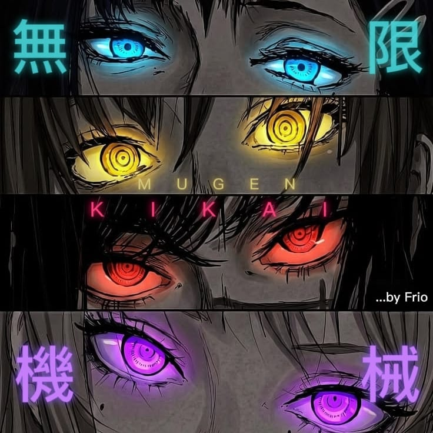

<div align="center">

# ⬩ MUGEN KIKAI ⬩

> *Destruction is only justifiable for remodel, never destroy, Build/Create!*  
> *~ frio*

[](https://nodejs.org/)
[](https://opensource.org/licenses/MIT)

Mugen Kikai is a WhatsApp group bot built for chaos, power, and competition.  
Collect cards, duel for rank, build an economy, gamble it all away — and if you're ambitious enough, run for President and take over the whole group.

</div>

---

## 🌟 What Is Mugen Kikai?



Mugen Kikai is not just a command bot. It's a living game inside your group chat:

- **A full political economy** — Elections, government, treasuries
- **A full card battle economy** — Collect, upgrade, and duel with anime cards
- **A full player economy** — Wallets, banks, robbing, loans, gambling
- **Group management** — Admin tools built for active groups

---

## 🏛️ DEMOCRACY — Political Economy

> *"Democracy is the worst form of government except for all the other forms that have been tried."*

Mugen Kikai introduces a complete timed election cycle:

### Election Cycle
`LOCKED` ➔ `REGISTRATION` ➔ `VOTING` ➔ `GOVERNMENT`

- Players purchase candidacy forms with in-game currency
- Limited slots per office — first come, first served
- Voters fund votes directly from their wallet
- Next election countdown is always visible

### Government Hierarchy
* **PRESIDENT** — Head of government. Executive powers.
* **VICE PRESIDENT** — Appointed by President
* **HEAD OF SECURITY (H.O.S)** — Appointed by President
* **GOVERNOR** — Per-group Governor

### Presidential Powers
- Appoint / dismiss Vice President, Head of Security, Governors
- Control state treasury
- Lead the government until next election

### Treasury System
Every office controls its own state treasury with a reserve-lock security to prevent total drain.
- Funds are protected — you can't empty a treasury in one go
- Withdrawals are tracked and limited

---

## ⚔️ DUEL — Card Battle System

Welcome to the Mugen Kikai Card Duel Arena! Real-time, turn-based tactical battles using your collected cards.

### Battle Flow — 4 Stages

| Stage | Description |
| :--- | :--- |
| **Stage 1: Challenge & Acceptance (15s)** | • Challenge a player<br>• Both players must own at least 1 Offense card<br>• Neither player can be in an active duel |
| **Stage 2: Offense Deck Selection (30s)** | • Select up to 2 Offense cards<br>• Fail to lock in = Immediate Forfeit |
| **Stage 3: Dual-Wing Defense Prep (30s)** | • Optional — Skip = Starting Shield = 0<br>• Equip Defense to Left Wing (Wing 1) and Right Wing (Wing 2)<br>• Combined Shield = Wing 1 + Wing 2<br>• No duplicate moves on both wings |
| **Stage 4: Combat Phase (3 Mins / 30s per Turn)** | • Challenged player goes first<br>• Shield absorbs damage first<br>• Turn timeout = 1 Strike + Skip turn<br>• 2 Strikes = Immediate Auto-Forfeit<br>• If match timer expires, winner = Highest Combined Stat (HP + Shield)<br>• Equal stats = Draw |

### XP & Rank
> *The old 1msg/XP system was cleared.*  
> XP is now based on duel wins only.

---

## 🃏 CARDS

Collect, upgrade, and battle with characters from across anime.

### Rarity & Base Power
* **Legendary** — `∆` — 45,000,000
* **Epic** — `∆∆` — 36,000,000
* **Rare** — `∆∆∆` — 25,200,000
* **Common** — `∆∆∆∆` — 12,600,000

### Rosters
* **Offense Cards:** Luffy, Naruto, Ichigo, Goku, Asta, Deku, Denji, Gon, Kaneki, Meliodas, Shinra, Tanjiro, Yuji, Goblin Slayer, Guts, Levi, Maki, Trevor, John Wick, Loid Forger, Mikey, Revy, Spike Spiegel + more
* **Defense Cards:** Android 17, Bartolomeo, Gojo, Itachi, Kirishima, Komamura, Sasuke, Tetsutetsu, Yami + more

### Upgrades
Cards scale with level. Defense shield scales with:  
$$\text{Shield} = \text{Base Points} \times 1.5^{(\text{Level} - 1)}$$

---

## 💰 ECONOMY & 🎰 GAMBLE

Build wealth, or lose it all.

### Economy Features
- Claim daily rewards (`firstclaim`, `claim`)
- Wallet + Bank system (`wallet`, `deposit`, `withdraw`, `give`)
- Player interaction (`rob`, `heavyrob`, `loan`)
- Competitive tracking (`leaderboard`)

### Gamble Games
Risk it all across: `gamble`, `coinflip`, `slots`, `dice`, `blackjack`, `roulette`, and `odds`.

---

## 🛡️ GROUP MANAGEMENT

- **Moderation:** `kick`, `promote`, `demote`, `mute`, `unmute`
- **Utility:** `tagall`, `hidetag`

---

## 🤖 COMMANDS REFERENCE

```text
├── BOT       │ owner, updates, ping, help, menu, whatsnew, runtime
├── CARDS     │ buy, mycards, card, upgrade
├── DUEL      │ duel, accept, off1, off2, def1, def2
├── USER      │ profile, rank, rankleaderboard
├── POLITICS  │ election, buyform, candidates, vote, hierarchy, appoint, unappoint, treasury, treasurywithdraw
├── GROUP     │ kick, promote, demote, mute, unmute, tagall, hidetag
├── ECONOMY   │ firstclaim, claim, wallet, deposit, withdraw, give, rob, heavyrob, loan, leaderboard
├── GAMBLE    │ gamble, coinflip, slots, dice, blackjack, roulette, odds
└── OTHERS    │ runtime
```
> *Full details in-bot: type `help`*

---

## ⚙️ Setup & Installation

```bash
# 1. Clone the repo
git clone [https://github.com/your-username/mugen-kikai.git](https://github.com/your-username/mugen-kikai.git)
cd mugen-kikai

# 2. Install dependencies
npm install

# 3. Add your config
# Fill in SESSION_ID, OWNER_NUMBER, PREFIX, MONGODB_URL etc.

# 4. Start the bot
npm start
```

### Requirements
- **Node.js:** 
- **WhatsApp:** Active account for pairing / QR
- **Database:** MongoDB / JSON DB (depending on your setup)

---

## 🛠️ Tech Stack
- **Runtime:** Node.js
- **WhatsApp API:** Baileys / WhatsApp-Web.js
- **Database:** JSON / MongoDB for player data, cards, elections, treasuries

---

## 🤝 Contributing

Pull requests are welcome. For major changes, open an issue first to discuss what you'd like to change.

**Ideas needed:**
- New cards / moves
- New election offices
- New gamble games
- Balance tweaks

---

## 📜 Credits & License

**Made by Frio**

*Mugen Kikai — Build / Create. Never destroy.*

Distributed under the **MIT License**. Feel free to use, modify, and build on. Just give credit.


**Terms and Conditions (T&C)**

* **WhatsApp Policy:** WhatsApp does NOT officially support bots. By using this, you acknowledge that your account could be flagged or banned by WhatsApp's automated systems.
* **Liability:** We are not responsible for any banned accounts, loss of data, or damages resulting from the use of this software.
* **Usage:** Use this bot responsibly. Avoid spamming commands in official or sensitive groups to reduce the risk of reports and bans.
* **Privacy:** This bot does not store your private messages; however, economy data and interaction logs are stored on a cloud based db.

---
